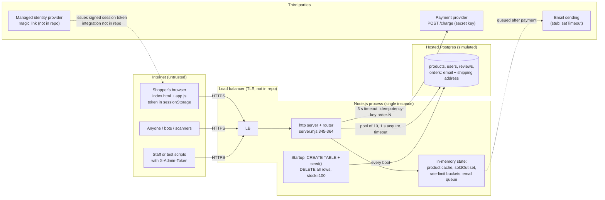

# System map

Commit `d572634` · 2026-10-16 · source: `demo/flash-sale/fixed/server.mjs` (377 lines), `demo/flash-sale/shared/public/*`

## Stack, hosting, deploy, environments
- **Runtime:** a single Node.js 22 process (`node:http`), no framework, **no third-party npm dependencies** and no lockfile (nothing for OSV-Scanner to check).
- **Front end:** one static page (`index.html` + `app.js` + `style.css`) served by the same process from memory, cached `public, max-age=300`, not fingerprinted.
- **Database:** hosted Postgres in production. In this repo, `shared/db.mjs` simulates it with in-memory SQLite, a 10-connection pool and ~3 ms per query. The app sets a 1 s pool acquire timeout (`server.mjs:41`).
- **Schema and data:** created **by the app at every start** (`server.mjs:42-62`): `CREATE TABLE …`, then `seed()` runs `DELETE FROM products; DELETE FROM users; DELETE FROM reviews; DELETE FROM orders;` and inserts stock = 100. No migration files.
- **Hosting:** one process behind a load balancer; a second instance may be added later. Deploy method, rollback and environments (staging?) are not described in the repo.
- **Config/secrets:** `PAYMENT_SECRET_KEY`, `TOKEN_SECRET`, `ADMIN_TOKEN` are required at boot (`server.mjs:11-13, 24-31`; the process exits if missing). `DEMO_LOGIN`, `PAYMENT_URL`, `PORT` are optional. `demo/flash-sale/run.mjs:20-23` supplies demo defaults and turns `DEMO_LOGIN` on; production takes them from the host's secret store (per owner).
- **Start command:** `package.json` has only `demo:naive` / `demo:fixed` scripts; there is no production start script in the repo.

## Components and trust boundaries

Trust boundaries: browser ↔ load balancer (everything from the browser is untrusted: price, product id, address, token); app ↔ database (pooled, parameterised SQL); app ↔ payment provider (server-side secret key, outbound only, **no inbound webhook**); admin callers are separated only by a shared static header token.

## Entry points

| # | Entry point | Who may call it | What stops everyone else | What it touches | Code |
|---|---|---|---|---|---|
| 1 | `GET /`, `/app.js`, `/style.css` | anonymous | nothing (public) | static files held in memory | `server.mjs:65-72, 347-351` |
| 2 | **Any request** (before routing) | anonymous | nothing: the request URL is parsed with `new URL()` outside the try/catch | process stability | `server.mjs:345-347` |
| 3 | `POST /api/login` | anonymous, **only when `DEMO_LOGIN=1`** (test stub) | flag off → 404; when on, no proof of email ownership | issues a signed token for any email | `server.mjs:15, 213-218` |
| 4 | `GET /api/products/:id` | anonymous | nothing (public) | products + reviews + reviewer names, 1 s single-flight cache keyed by id | `server.mjs:154-174, 220-224` |
| 5 | `GET /api/search?q=` | anonymous (front end never calls it) | nothing; not cached, not rate-limited | `products` (LIKE, escaped, LIMIT 20) | `server.mjs:226-229` |
| 6 | `POST /api/buy` | signed-in shopper | HMAC token check; 5 attempts / 10 s per email | stock reservation, `orders` (email, amount, address), payment provider, email queue, `soldOut` set | `server.mjs:231-282` |
| 7 | `GET /api/orders/:id` | owner of the order | token + `WHERE id = ? AND customer = ?` | `orders` (no address returned) | `server.mjs:284-293` |
| 8 | `GET /api/my-orders` | signed-in shopper (own orders) | token; `WHERE customer = ?` | `orders` with status `paid` | `server.mjs:295-299` |
| 9 | `GET /healthz` | anonymous | nothing (public) | returns pool stats (size, in use, waiting) | `server.mjs:301` |
| 10 | `POST /api/admin/reset` | admin | shared `X-Admin-Token`, timing-safe compare, 404 on mismatch | **deletes all products, users, reviews and orders**, reseeds stock, clears caches and rate limits, calls provider `/reset` | `server.mjs:303-312` |
| 11 | `GET /api/admin/stats` | admin | shared `X-Admin-Token` | stock, paid-order counts, provider `/stats` (a test-only provider endpoint) | `server.mjs:314-326` |
| 12 | Startup | process start / restart | n/a | `CREATE TABLE`, then `DELETE FROM` every table, stock = 100 | `server.mjs:42-62` |
| 13 | Background: email workers | internal | n/a | in-memory queue, 5 workers, simulated 250 ms SMTP call (no email sent) | `server.mjs:197-210` |
| 14 | Background: rate-limit sweep | internal, every 10 s | n/a | in-memory buckets | `server.mjs:148-151` |
| 15 | Outbound: payment charge | app → provider | Bearer `PAYMENT_SECRET_KEY` | charges `price_cents` for `customer: email`, key `order-<id>`, 3 s abort | `server.mjs:179-192, 266` |
| 16 | Signal handlers (SIGTERM/SIGINT) | platform | n/a | stop accepting, finish in-flight, force exit after 10 s | `server.mjs:371-377` |

Not present (checked): no inbound webhooks (the provider can't tell the app about a late or disputed charge), no cron jobs, no file uploads, no direct browser-to-database access (no Supabase/Firebase), no CORS headers (same-origin only), no AI/LLM calls.

## Data stores and sensitive data

| Store | Holds | Sensitivity |
|---|---|---|
| Postgres `orders` | customer email, shipping address (≤ 500 chars), amount, status (`pending` / `paid` / `payment_failed`), created_at (UTC) | personal data |
| Postgres `users`, `reviews`, `products` | reviewer first names, review text, product, price (cents), stock (`CHECK stock >= 0`) | public |
| Process memory | rate-limit buckets keyed by email, `soldOut` set, product cache, email queue (email + order id) | personal data (transient) |
| Browser `sessionStorage` | session token and email | session credential |
| Environment | `PAYMENT_SECRET_KEY`, `TOKEN_SECRET`, `ADMIN_TOKEN` | secrets |

## Third parties

| Service | How it's called | Notes |
|---|---|---|
| Payment provider (Stripe-like) | server-side `fetch` with secret key, `idempotency-key: order-<orderId>`, `AbortSignal.timeout(3000)` | No card collection in the front end and no inbound webhook; the real card integration (payment method, 3-D Secure, declines, refunds) is **not in the repo**. |
| Managed identity provider (magic link) | not in the code | The server verifies only its own `payload.HMAC` token format (`server.mjs:114-127`); how the IdP issues that format is not in the repo. |
| Email (confirmation) | `queueConfirmationEmail()` | Stub: waits 250 ms and sends nothing (`server.mjs:205`). |
