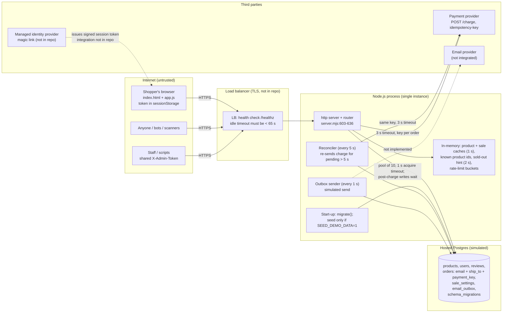

# System map (round 2)

Commit `fa296a2` · 2026-10-17 · source: `demo/flash-sale/fixed/server.mjs` (657 lines), `demo/flash-sale/shared/public/*`, `demo/flash-sale/fixed/RUNBOOK.md`

## What changed since round 1 (`git diff d572634 fa296a2`)
- Request URL parsed inside the error handler; every request wrapped; `unhandledRejection` logged (`server.mjs:603-644`).
- Payments: one random idempotency key per order (`payment_key`), a timeout or unclear answer = "unknown" (202 "confirming", pair stays reserved), only a 402 decline releases the pair; post-charge writes go through `settle()` (no pool timeout, 5 attempts); a **reconciler** every 5 s re-sends the charge for pending orders older than 5 s (`server.mjs:294-387`).
- **Durable email outbox** table filled in the same transaction as "paid", drained every second (`:389-408`); sending is still simulated (`:397`).
- **Shipping address** required (10–300 chars) and unique per product among live orders, next to the existing one-per-customer index (`:79-87, 411-415`).
- **Sale settings** table (`starts_at`, `paused`) read through a 1 s cache; new admin endpoint `POST /api/admin/sale` (`:88, 283-286, 417-425, 532-548`); `SALE_STARTS_AT` required in production (`:24-26`).
- **Versioned migrations** with a `schema_migrations` table; nothing destructive at start-up; demo data only with `SEED_DEMO_DATA=1`; reset route only with `ENABLE_TEST_ROUTES=1`; production refuses demo flags and placeholder secrets (`:10-52, 68-139, 571-585`).
- `/api/search` removed; unknown product ids answered from an in-memory id set (`:245-253, 437-443`).
- Structured JSON logs without emails (`:61-66`); `/healthz` liveness, `/readyz` readiness (`:520-529`); keep-alive 65 s (`:637-641`); content-hashed asset URLs, HTML `no-cache` (`:141-152, 611-617`).
- Front end: address field, sale status/countdown, retry with backoff, 401 → sign in again, "confirming" polling, 15 s request timeout, sold-out re-check (`app.js`, `index.html`).
- New `RUNBOOK.md` for launch night.

## Stack, hosting, deploy, environments
- **Runtime:** a single Node.js 22 process (`node:http`), no framework, no third-party npm dependencies, no lockfile.
- **Front end:** one static page served from memory; `index.html` `no-cache`, `app.js`/`style.css` referenced as `?v=<sha256 prefix>` and served `immutable` for a year.
- **Database:** hosted Postgres in production (simulated). App pool acquire timeout 1 s for ordinary queries; `settle()` and start-up use "wait as long as it takes".
- **Schema:** 4 append-only migrations applied **by the app at start-up** (`migrate()`), not by a separate deploy step. No down-migrations.
- **Stock loading in production:** "a one-off, audited admin script" (`server.mjs:117`), **not in the repo**. Without `SEED_DEMO_DATA` the products table is empty (`GET /api/products/1` → 404 on a production-mode start).
- **Config/secrets:** `PAYMENT_SECRET_KEY`, `TOKEN_SECRET`, `ADMIN_TOKEN` required; in production also ≥ 32 chars and not demo-looking; `SALE_STARTS_AT` required in production; `PAYMENT_URL` optional with a default of `http://127.0.0.1:4100`. All production guards key off `NODE_ENV === 'production'`. No production start script, Dockerfile or deploy config in the repo.

## Components and trust boundaries

Trust boundaries: browser ↔ load balancer (price, product id, address and token are untrusted; the server ignores the price and validates the rest); app ↔ database (parameterised SQL only); app ↔ payment provider (server-side secret key, outbound only, **no inbound webhook**); admin callers are separated only by one shared static header token.

## Entry points

| # | Entry point | Who may call it | What stops everyone else | What it touches | Code |
|---|---|---|---|---|---|
| 1 | `GET /`, `/app.js`, `/style.css` (any `?v=`) | anonymous | nothing (public) | static files in memory | `server.mjs:141-152, 611-617` |
| 2 | **Any request** (before routing) | anonymous | URL parse inside `try` → 400; handler wrapped; `unhandledRejection` logged | process stability | `server.mjs:603-644` |
| 3 | `POST /api/login` | anonymous, **only when `DEMO_LOGIN=1`** (refused in production) | flag off → 404 | issues a token for any email, lower-cased and `+tag` stripped | `server.mjs:428-435` |
| 4 | `GET /api/products/:id` | anonymous | known-id set → 404 without the DB | product + reviews (1 s single-flight cache), sale settings (1 s cache) | `server.mjs:437-443` |
| 5 | `POST /api/buy` | signed-in shopper | HMAC token; 5 attempts / 10 s per email (in memory); address 10–300 chars; sale open & not paused | reservation + pending order (one txn), payment, `settle()`, outbox | `server.mjs:445-501` |
| 6 | `GET /api/orders/:id` | owner of the order | token + `WHERE id = ? AND customer = ?` | `orders` (no address/email returned); uncached, unlimited | `server.mjs:503-512` |
| 7 | `GET /api/my-orders` | signed-in shopper (own paid orders) | token; `WHERE customer = ?` | `orders`; uncached, unlimited; not called by the page | `server.mjs:514-518` |
| 8 | `GET /healthz` | anonymous | nothing (public) | returns `{ok:true}` only | `server.mjs:522` |
| 9 | `GET /readyz` | anonymous | 1 s cache | `SELECT 1`; `{ok}` only | `server.mjs:526-529` |
| 10 | `POST /api/admin/sale` | admin | shared `X-Admin-Token`, timing-safe, 404 on mismatch; logged without identity | `sale_settings.paused`, `starts_at` (lenient date parse) | `server.mjs:532-548` |
| 11 | `GET /api/admin/stats` | admin | shared `X-Admin-Token` | counts from the DB; provider `/stats` only with test routes | `server.mjs:550-568` |
| 12 | `POST /api/admin/reset` | admin, **only when `ENABLE_TEST_ROUTES=1`** (refused in production) | not registered otherwise | wipes all tables, reseeds, clears caches, provider `/reset` | `server.mjs:571-585` |
| 13 | Start-up | process start / restart | n/a | `migrate()`; `INSERT OR IGNORE` sale settings from `SALE_STARTS_AT` (first boot only); seed only with `SEED_DEMO_DATA=1` | `server.mjs:93-139` |
| 14 | Background: reconciler | internal, every `RECONCILE_INTERVAL_MS` (5 s) | n/a | up to 50 oldest pending orders, sequentially re-sends the charge; alert log after 10 min | `server.mjs:363-387` |
| 15 | Background: outbox sender | internal, every 1 s | n/a | 20 unsent emails per tick, simulated send, mark sent | `server.mjs:389-408` |
| 16 | Background: product-id refresh (30 s), rate-limit sweep (10 s) | internal | n/a | in-memory sets/maps | `server.mjs:239-253` |
| 17 | Outbound: payment charge | app → provider | Bearer `PAYMENT_SECRET_KEY` | `amountCents`, `customer: email`, `idempotency-key: payment_key`, 3 s abort | `server.mjs:299-310` |
| 18 | Signal handlers (SIGTERM/SIGINT) | platform | n/a | stop timers, finish in-flight requests, force exit after 10 s | `server.mjs:649-657` |

Not present (checked): inbound payment webhook, provider lookup API call, cron jobs, uploads, browser-to-database access, CORS headers, AI/LLM calls, an order-history view in the page, a production sign-in UI (the page's form posts to the test stub), an admin tool to resolve a stuck order, an address export, a stock-loading script.

## Data stores and sensitive data

| Store | Holds | Sensitivity |
|---|---|---|
| Postgres `orders` | customer email, `ship_to` (≤ 300 chars) and its normalised key, amount, `payment_key`, status (`pending`/`paid`/`payment_failed`), created/updated ms | personal data |
| Postgres `email_outbox` | order id, customer email, created/sent ms | personal data |
| Postgres `sale_settings` | opening time (UTC ISO), paused flag | business-critical config |
| Postgres `products`, `users`, `reviews`, `schema_migrations` | product, price (cents), stock (`CHECK stock >= 0`), reviewer first names, migration versions | public / internal |
| Process memory | rate-limit buckets keyed by email, known product ids, caches, sold-out hint | transient |
| Logs (stdout JSON) | events with order ids and an HMAC customer reference; no emails or addresses (checked on a local run) | pseudonymous |
| Browser `sessionStorage` | session token and email (per tab, cleared when the tab closes) | session credential |
| Environment | `PAYMENT_SECRET_KEY`, `TOKEN_SECRET`, `ADMIN_TOKEN`, `SALE_STARTS_AT`, `PAYMENT_URL` | secrets / config |

## Third parties

| Service | How it's called | Notes |
|---|---|---|
| Payment provider (Stripe-like) | server-side `fetch`, secret key, `idempotency-key` per order, `AbortSignal.timeout(3000)`; reconciler repeats the same request | No card collection on the page, no payment method in the request, no webhook, no lookup call. The production card integration is **not in the repo**. |
| Managed identity provider (magic link) | not in the code | The server verifies only its own `payload.HMAC` format; the page's sign-in form calls the test stub. |
| Email provider | not integrated | Outbox rows are marked sent after a 50 ms `setTimeout` (`server.mjs:397`). |
