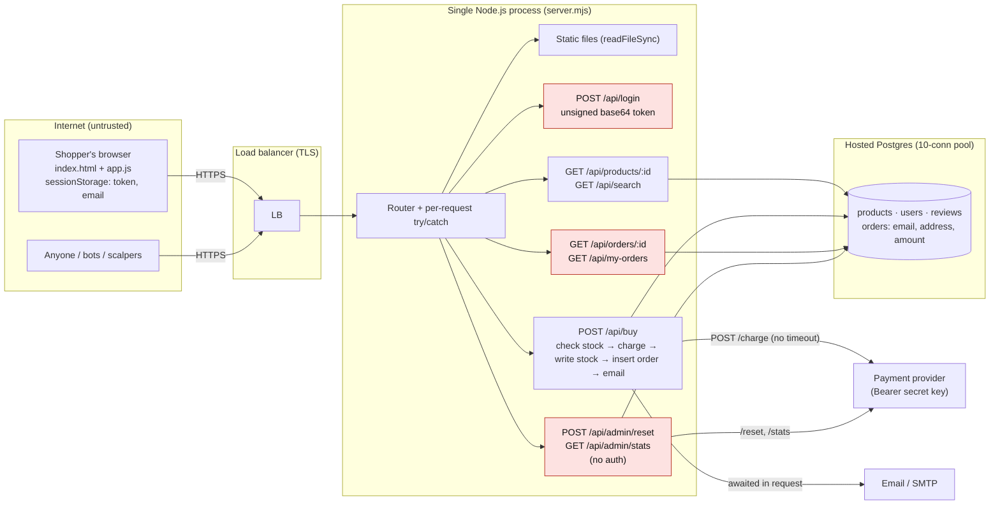

# System map

Commit `d572634`. Source: `demo/flash-sale/naive/server.mjs` (178 lines, the whole backend) and `demo/flash-sale/shared/public/` (frontend).

## Stack, hosting, deploy
- **Runtime:** Node.js 22, a single `node:http` server (`server.mjs:165-178`), hand-written router (`server.mjs:153-163`). No framework, no `package.json`, no lockfile, no npm dependencies.
- **Frontend:** static `index.html`, `app.js`, `style.css`, served by the same process (`server.mjs:66-77`). Plain DOM code, all text rendered with `textContent`.
- **Hosting (owner's plan):** one Node.js process behind a load balancer; hosted Postgres. TLS is expected to end at the load balancer (the app speaks plain HTTP).
- **Deploy method:** none in the repo (no Dockerfile, Procfile, CI workflow or IaC). `demo/flash-sale/run.mjs` is a local launcher that starts the app plus the simulated payment provider and stops both if either exits (`run.mjs:36-41`).
- **Environments:** only local. The code has no notion of environment: the payment key is hard-coded with a `pay_live_…` prefix (`server.mjs:10`), so dev, test and production would all use the same key.
- **Schema / data setup:** `CREATE TABLE …` and a full `seed()` (which deletes every order) run on every process start (`server.mjs:13-27`). No migrations.

## Entry points

| # | Route | Who can call it today | Who should | What it touches | Code |
|---|---|---|---|---|---|
| 1 | `GET /` , `GET /app.js`, `GET /style.css` | anonymous | anonymous | reads files from disk (`readFileSync`) on every request | `server.mjs:66-77` |
| 2 | `POST /api/login` | anonymous | anonymous (rate-limited) | nothing stored; returns `base64({"email": <any value>})` as the "token" | `server.mjs:79-83` |
| 3 | `GET /api/products/:id` | anonymous | anonymous | `products`, `reviews`, `users` (1 + 1 + 12 queries) | `server.mjs:85-94` |
| 4 | `GET /api/search?q=` | anonymous | anonymous | `products` (query built from the `q` string) | `server.mjs:96-100` |
| 5 | `POST /api/buy` | anyone with a self-made token | signed-in customer, once | reads `products`, **charges the card via the payment provider**, writes `products.stock`, inserts `orders`, "sends" email (250 ms) | `server.mjs:102-118` |
| 6 | `GET /api/orders/:id` | **anonymous** | owner of the order | `orders` (email, address, amount) | `server.mjs:120-124` |
| 7 | `GET /api/my-orders` | anyone with a self-made token | signed-in customer | `orders WHERE customer = token.email` | `server.mjs:126-130` |
| 8 | `POST /api/admin/reset` | **anonymous** | nobody in production (test-only) | deletes all orders, resets stock to any value, calls provider `/reset` | `server.mjs:132-137` |
| 9 | `GET /api/admin/stats` | **anonymous** | admin | sales and payment totals, calls provider `/stats` | `server.mjs:139-150` |
| – | any other path / method (incl. `OPTIONS`) | anonymous | – | 404 JSON | `server.mjs:168` |

No webhooks, cron jobs, queues, server actions or browser-to-database access exist. The only error handler is the per-request `try/catch` at `server.mjs:169-175`; there is no process-level handler.

## Data stores
| Store | Holds | Sensitivity |
|---|---|---|
| Hosted Postgres (simulated: SQLite in memory behind a 10-connection pool, ~3 ms per query, pool waits forever: `shared/db.mjs:22-27`, opened with defaults at `server.mjs:13`) | `products` (price, stock), `users` (reviewer names only), `reviews`, `orders` (customer email, shipping address, amount, status) | Personal data (email, address); no card data |
| Browser `sessionStorage` | `token`, `email` (`app.js:4-5, 46-47`) | Session token (forgeable, see SEC findings) |
| Server stdout log | `email sent to <customer email> for order <id>` (`server.mjs:62`), full error stacks (`server.mjs:172`) | Personal data in logs |

## Third parties
| Service | How it's called | Auth | Timeout / retry |
|---|---|---|---|
| Payment provider (`PAYMENT_URL`, default `http://127.0.0.1:4100`) | `POST /charge {amountCents, customer}` from `chargeCard()` (`server.mjs:49-57`); `POST /reset` and `GET /stats` from admin routes (`server.mjs:135, 142`) | `Authorization: Bearer pay_…` (hard-coded key, `server.mjs:10`) | none; no idempotency key |
| Email (SMTP, simulated) | `sendConfirmationEmail()` awaited inside the buy request (`server.mjs:59-63, 116`) | – | none |

## Diagram

Trust boundaries: browser → load balancer (everything the browser sends, including `price` and the token, is attacker-controlled); app → database (one shared pool for every request); app → payment provider (holds the secret key); app → email.
